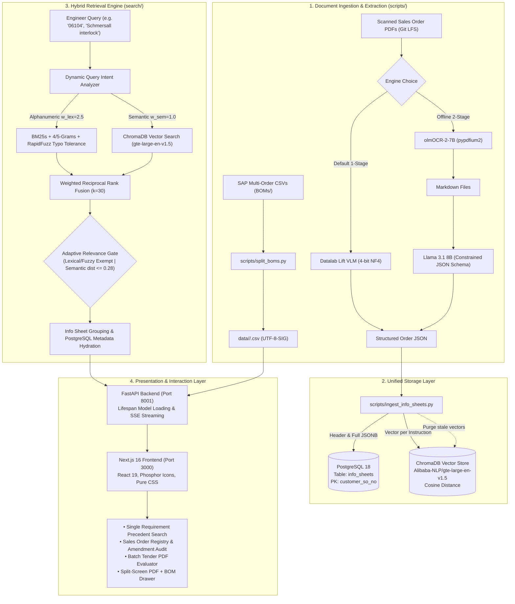

<div align="center">

# 🔎 ACE Designers Sales Order Search Engine

### Intelligent Hybrid Retrieval & Technical Precedent Discovery for Industrial Machine Tools

**Transform scanned sales order specification sheets and SAP Bills of Materials (BOM) into an indexed engineering knowledge base — combining Neural Document VLMs, Dense Vector Semantic Search, Sub-Token & N-Gram BM25s, RapidFuzz Typo Tolerance, and Weighted Reciprocal Rank Fusion.**

<br/>

[](https://www.python.org/)
[](https://fastapi.tiangolo.com/)
[-000000?style=for-the-badge&logo=next.js&logoColor=white)](https://nextjs.org/)
[](https://www.postgresql.org/)
[](https://www.trychroma.com/)
[](https://www.docker.com/)
[](https://git-lfs.com/)
[](#-confidentiality--intellectual-property)

<br/>

[](https://github.com/pavanshenoy21/ace-infosheet)
[](tests/)
[](#-corpus-scale--telemetry)

</div>

---

## 🎯 Executive Overview & Problem Statement

In industrial manufacturing (CNC lathes, turning centers, multi-axis machining tools), customer orders rarely conform to stock catalogue specifications. Machine design proposals frequently demand bespoke engineering accommodations:
- Custom workholding, hydraulic chucking, and collet arrangements
- Programmable tailstocks, dual-pressure quill controls, and steady rests
- Coolant configurations (through-coolant, high-pressure bed wash, mist collectors)
- Specialized third-party interlocks, linear scales, and tool probes (Renishaw, Schmersal, Heidenhain)

### The Legacy Quoting Bottleneck
Historically, applications engineers, proposal specialists, and machine designers relied on manual keyword searches across ERP (SAP) descriptions or static Excel logs. This workflow suffers from critical failure modes:
1. **Terminology Divergence**: An engineer searching for *"spindle blast cleaning"* misses historical orders described as *"air blow for chuck jaws"*.
2. **Identifier Sensitivity**: Part numbers (`06104A013B`), CNC controller options (`828D`, `0i-TF`), and machine families (`LT-20 C CLASSIC`) are obscured by differing punctuation, casing, or abbreviation conventions.
3. **Decoupled Bill of Materials**: The sales order specification sheet, customer amendment records, and SAP production BOMs existed in separate silos, forcing manual cross-verification.

### The Solution: ACE Infosheet Search Platform
This platform extracts, standardizes, indexes, and surfaces verified historical build precedents. Given a newly drafted special instruction or an entire scanned quotation sheet, the system retrieves historically validated precedents with their corresponding CAD/PDF drawings and SAP BOM component hierarchies in sub-second response times.

---

## ✨ Key Platform Capabilities

| Capability | Description | Subsystem & Technical Anchor |
| :--- | :--- | :--- |
| **🧠 Industrial Hybrid Search** | Integrates dense semantic vector embeddings with sparse sub-token BM25 retrieval, character 4/5-grams, and RapidFuzz typo tolerance fused via Weighted RRF ($k=30$). | `search/`, [`docs/SEARCH_ENGINE_ARCHITECTURE.md`](docs/SEARCH_ENGINE_ARCHITECTURE.md) |
| **📑 Dual VLM Ingestion** | Modern 1-stage direct extraction via 4-bit quantized **Datalab Lift VLM**, with an offline 2-stage OCR/LLM fallback (`olmOCR-2-7B` + `Llama 3.1 8B Instruct`). | `scripts/`, [`docs/PIPELINE_AND_DATA.md`](docs/PIPELINE_AND_DATA.md) |
| **🔄 Live SSE Precedent Tender Audit** | Upload an entire incoming multi-page tender PDF; Server-Sent Events stream extraction and precedent retrieval live across 5 discrete pipeline stages. | `POST /search/document/pdf`, `frontend/src/app/(app)/document-search/` |
| **📦 Interactive BOM Grid** | Inspect 32 SAP assembly fields, toggle 8 essential columns, filter by assembly levels (`L1 Major` vs `Sub-assemblies`), and export formatted `.xlsx` workbooks. | `backend/api/documents.py`, `frontend/src/components/search/BomGrid.tsx` |
| **🪟 Split-Screen Engineering Drawer** | Cross-reference scanned engineering drawings side-by-side with live SAP BOM assemblies in a dual-pane workspace. | `frontend/src/components/search/DocumentDrawer.tsx` |
| **📜 Amendment History Auditing** | Automatically resolves sales order amendments. PostgreSQL retains the latest revision while stale ChromaDB vectors are purged on supersession. | `scripts/ingest_info_sheets.py`, `scripts/sync_and_seed.py` |
| **🎨 Industrial Editorial Design** | Purpose-built desktop UI featuring pure CSS typography tokens (`Newsreader`, `IBM Plex Sans/Mono`), Phosphor iconography, and zero component-library bloat. | `frontend/src/app/globals.css`, React 19 / Next.js 16 |

---

## 🏗️ System Architecture



---

## 🧰 Technology Matrix

| Layer | Primary Technology | Version / Specification | Rationale & Responsibility |
| :--- | :--- | :--- | :--- |
| **Language** | Python | `3.11+` | Pipeline processing, model inference, and backend runtime. |
| **Web Framework** | FastAPI | `^0.115` | Async API, dependency injection, lifespan resource management, SSE streaming. |
| **ASGI Server** | Uvicorn | `^0.30` | Production ASGI server with multi-directory file watching. |
| **Relational DB** | PostgreSQL | `18` | Stores headers, dates, full extraction JSONB, and primary keys. |
| **Database Driver** | SQLAlchemy & Psycopg 3 | `SQLAlchemy ^2.0`, `psycopg ^3.2` | High-performance PostgreSQL driver using native connection pooling. |
| **Vector Store** | ChromaDB | `^1.0` | In-process persistent vector store using cosine distance indexing. |
| **Dense Embeddings** | SentenceTransformers | `Alibaba-NLP/gte-large-en-v1.5` | 1024-dim dense representation with custom rotary buffer patch. |
| **Sparse Retrieval** | BM25s | `^0.2` | High-speed in-memory BM25 retrieval with alphanumeric sub-token indexing. |
| **Fuzzy Matching** | RapidFuzz | `^3.9.0` | Dynamic Levenshtein edit distance vocabulary correction on technical terms. |
| **Document VLM** | Datalab Lift VLM | `datalab-to/lift` (4-bit NF4) | End-to-end direct PDF-to-JSON neural clause extraction. |
| **OCR Fallback** | olmOCR & Llama 3.1 | `olmOCR-2-7B-GGUF`, `llama3.1:8b` | Local Ollama vision OCR and JSON-schema constrained extraction. |
| **PDF Processing** | pypdfium2 & Pillow | `pypdfium2 ^4.30`, `Pillow ^10.0` | High-fidelity page rasterization without external system poppler dependencies. |
| **Frontend Framework**| Next.js | `16.0.0` (App Router) | High-performance React 19 application with standalone Node deployment. |
| **Styling** | Pure CSS Tokens | Custom `globals.css` (3,400+ lines) | Strict Industrial Editorial design system adhering to `DESIGN.md`. |
| **Iconography** | Phosphor Icons | `@phosphor-icons/react ^2.1` | Precision industrial vector iconography. |
| **Spreadsheet Engine**| ExcelJS & FileSaver | `exceljs ^4.4`, `file-saver ^2.0` | In-browser dual-table styled `.xlsx` workbook generation. |
| **Containers** | Docker & Compose | Compose V2 with Compose Watch | Containerized deployment with volume mounts, GPU reservations, and watch sync. |

---

## ⚡ Quickstart Guide

### Prerequisites
- **Git** with **Git LFS** installed (`git lfs --version`)
- **Docker Engine** (`24.0+`) & **Docker Compose** (`v2.20+`)
- *Optional (for local GPU inference)*: NVIDIA Driver supporting CUDA 12+, NVIDIA Container Toolkit

---

### Step 1: Clone Repository & Pull Large Files
Because source PDFs and extracted JSON documents are versioned via Git LFS, initialize LFS before pulling:

```bash
git clone https://github.com/pavanshenoy21/ace-infosheet.git
cd ace-infosheet

# Initialize Git LFS and download tracked PDFs/JSONs
git lfs install
git pull
git lfs pull
```

---

### Step 2: Configure Environment
Copy the environment template and configure database credentials:

```bash
cp .env.example .env
```

Review `.env`:
```ini
POSTGRES_DB=info_sheets
POSTGRES_USER=info_user
POSTGRES_PASSWORD=password123
POSTGRES_PORT=5433
BACKEND_PORT=8001
FRONTEND_PORT=3000
EMBED_DEVICE=cpu          # Set to 'cuda' if GPU passthrough is enabled
```

---

### Step 3: Launch Containers via Docker Compose
Start PostgreSQL, the FastAPI backend, and the Next.js frontend with one command:

```bash
docker compose up -d --build
```

Verify service health:
```bash
docker compose ps
```

| Service | Container Name | Host Port | Internal Port | Status / Healthcheck |
| :--- | :--- | :--- | :--- | :--- |
| **PostgreSQL** | `info-sheets-postgres` | `127.0.0.1:5433` | `5432` | `pg_isready -U info_user` |
| **FastAPI Backend** | `info-sheets-backend` | `0.0.0.0:8001` | `8001` | `curl -f http://localhost:8001/health` (180s start period) |
| **Next.js Frontend**| `info-sheets-frontend` | `0.0.0.0:3000` | `3000` | Running via Node development target |

---

### Step 4: Sync & Seed Databases
Seed your local PostgreSQL and ChromaDB instances from the version-controlled `data/` directory:

```bash
# Run the all-in-one data validation and seeding engine
python -m scripts.sync_and_seed
```

This single command:
1. Validates Git LFS file integrity across all document directories.
2. Ensures PostgreSQL is healthy (starting containers if down).
3. Evaluates sales order amendments and isolates the canonical latest revisions.
4. Resets database tables and encodes 18,000+ vectors into ChromaDB.
5. Emits an audit summary report of indexed orders and vectors.

**Open the Application**:
- 🖥️ **Web Interface**: [`http://localhost:3000`](http://localhost:3000)
- 📚 **Interactive Swagger API Docs**: [`http://localhost:8001/docs`](http://localhost:8001/docs)

---

## 🛠️ Local Development (Without Containers)

If developing Python services or Next.js components directly on your host:

### 1. Python Environment Setup
```bash
python -m venv .venv
source .venv/bin/activate

# Install all dependencies (Pipeline, Search, Backend, Tests)
pip install -r requirements.txt
```

### 2. Start PostgreSQL via Docker
Run only the database container:
```bash
docker compose up -d postgres
```

### 3. Start Backend Development Server
```bash
python -m uvicorn backend.main:app --reload --port 8001
```

### 4. Start Frontend Development Server
```bash
cd frontend
npm install
npm run dev
```

---

## 🔬 Core Subsystems Deep-Dive

### 1. Hybrid Retrieval Engine (`search/`)
Full architectural specification: [`docs/SEARCH_ENGINE_ARCHITECTURE.md`](docs/SEARCH_ENGINE_ARCHITECTURE.md).

```
User Query: '06104', 'Schmersall interlock', or 'chip conveyor with coolant'
                             │
            ┌────────────────┴────────────────┐
            ▼                                 ▼
   Sparse Lexical Search             Dense Semantic Search
   • Delimiter Splitting             • Alibaba-NLP/gte-large-en-v1.5
   • Sub-token & Char 4/5-Grams      • Cosine Distance Index
   • RapidFuzz Typo Tolerance        • 1024-Dimensional Vectors
            │                                 │
            └────────────────┬────────────────┘
                             ▼
              Weighted Reciprocal Rank Fusion (wRRF)
              Score = w_lex / (k + r_lex) + w_sem / (k + r_sem)
              (k=30; Alphanumeric bias: w_lex=2.5, w_sem=1.0)
                             │
                             ▼
                  Adaptive Relevance Gate
   • Lexical hits (matched_terms >= 1) ──► Unconditionally Preserved
   • Fuzzy typo hits (score > 0)       ──► Unconditionally Preserved
   • Semantic-only candidates          ──► Must satisfy distance <= 0.28
```

- **Alphanumeric N-Gram Indexing**: Standard tokenizers fail on partial codes. The lexical engine generates character 4-gram and 5-gram sliding windows for tokens containing numbers, allowing `06104` to match component `06104A013B`.
- **RapidFuzz Typo Tolerance**: Evaluates out-of-vocabulary query terms against a dynamic dictionary of ~4,500 unique engineering terms using Levenshtein distance $\le 2$. Mapped hits receive a calibrated score penalty (e.g. $0.80$ for edit distance 1), guaranteeing that exact spellings rank strictly above typos while eliminating 0-result failures.
- **Weighted Reciprocal Rank Fusion**: Replaces standard flat $k=60$ web search fusion with domain-calibrated $k=30$ and dynamic weighting:
  $$\text{RRF}(d) = w_{\text{lex}} \cdot \frac{1}{30 + \text{rank}_{\text{lex}}(d) + 1} + w_{\text{sem}} \cdot \frac{1}{30 + \text{rank}_{\text{sem}}(d) + 1}$$
- **Rotary Buffer Model Patches**: Automatically resolves uninitialized rotary embedding buffers in `gte-large-en-v1.5` that otherwise corrupt cosine distances under fast PyTorch tensor allocation.

---

### 2. Data Pipelines & Checkpointing (`scripts/`)
Full operational pipeline guide: [`docs/PIPELINE_AND_DATA.md`](docs/PIPELINE_AND_DATA.md).

- **1-Stage Lift VLM Pipeline (Default)**:
  Directly processes scanned PDF pages to JSON using `datalab-to/lift` 4-bit NF4 quantization.
  ```bash
  python -m scripts.run_pipeline --engine lift --dir "OneDrive_6_7-7-2026"
  ```
- **2-Stage OCR + Extraction Pipeline (Offline / Ollama)**:
  Modular pipeline using `olmOCR-2-7B` for Markdown extraction and `Llama 3.1 8B Instruct` for constrained JSON generation.
  ```bash
  python -m scripts.run_pipeline --engine 2stage --dir "OneDrive_6_7-7-2026"
  ```
- **State Checkpointing (`pipeline_state.sqlite3`)**:
  All batch scripts write to an atomic SQLite checkpoint store, enabling interrupted jobs to resume without duplicating OCR or extraction steps.
- **Live Terminal Dashboard**:
  ```bash
  python -m scripts.pipeline_status --dir "OneDrive_6_7-7-2026"
  ```
  Renders live ASCII sparklines of throughput, stage completion percentages, GPU VRAM allocation, and categorized error tables.

---

### 3. Bill of Materials (BOM) & Document Drawer

```
┌──────────────────────────── Document Drawer ─────────────────────────────┐
│ [Single View]  [Split View]  |  SO: 360017455  |  Model: LT-20 C CLASSIC │
├───────────────────────────────────┬──────────────────────────────────────┤
│        Scanned Order PDF          │        Interactive SAP BOM           │
│                                   │  Filter: [ All | L1 Major | Subs ]   │
│  • Customer: GA STEEL             │  Columns: [8 Essential | 32 All]     │
│  • BP No: 200142                  │                                      │
│  • Drawing / Special Clauses:     │  Level | Item | Component | Desc     │
│    1. CHUCK SIZE: 200 MM 3 JAW    │  L1    | 0010 | 10100122  | HYD PACK │
│    2. SCHMERSAL SAFETY INTERLOCK  │  └ L2  | 0020 | 06104A013B| MANIFOLD │
│    3. VOLTAGE STABILIZER 20KVA    │  └ L2  | 0030 | 08102B001A| SOLENOID │
│                                   │                                      │
│  [Open in New Tab]                │  [Export Excel (.xlsx)]  [Download]  │
└───────────────────────────────────┴──────────────────────────────────────┘
```

- **SAP Multi-Order CSV Splitting**:
  `scripts/split_boms.py` parses multi-megabyte SAP dumps in `BOMs/`, isolates 9-digit order numbers matching directory names in `data/`, and outputs clean `data/<stem>/<stem>.csv` files.
- **Interactive BOM Grid Controls**:
  - Full-text multi-column search
  - Assembly level segmented tabs (`All`, `L1 Major`, `Sub-assemblies`)
  - Visual hierarchy tree indentation (`marginLeft: (level - 1) * 12px`)
  - One-click part number clipboard copying
  - In-browser client-side Excel (`.xlsx`) generation via `ExcelJS`
- **Split-Screen Workspace**:
  Toggling Split View in `DocumentDrawer.tsx` positions the original scanned customer PDF alongside the parsed SAP BOM, enabling instant technical cross-verification.

---

### 4. Application Workflows

1. **Instruction Search (`/instruction-search`)**:
   Search specific engineering options, coolant systems, or safety configurations in natural language. Results present individual matched instructions with detailed evidence telemetry: semantic distance, BM25 score, fused score, and amendment tags.
2. **Sales Order Registry (`/so-lookup`)**:
   Keyboard-navigable autocomplete combobox searching by customer SO number, customer name, or machine model. Displays complete build sheets, highlights post-contract engineering amendments, and downloads structured two-table Excel workbooks.
3. **Batch Tender Matcher (`/document-search`)**:
   Drag-and-drop an entire scanned quotation sheet PDF. Server-Sent Events (SSE) stream 5-stage progress (Rasterization, VLM Readiness, Neural Extraction, Normalization, Precedent Retrieval) with a real-time elapsed timer, presenting an extracted order banner and ranked precedent build sheets.

---

## 📡 REST & SSE API Reference

Comprehensive endpoint specification: [`docs/API_REFERENCE.md`](docs/API_REFERENCE.md).

| Method | Endpoint | Description |
| :--- | :--- | :--- |
| `GET` | `/health` | Liveness probe returning `{"status": "ok"}`. |
| `GET` | `/stats` | Global corpus grounding metrics (instructions, sheets, customers, models, vectors). |
| `POST` | `/search` | Hybrid search query with optional filters (`material`, `material_id`, `date_from`, `date_to`, `exact_match`). |
| `GET` | `/so/{customer_so_no}` | Retrieves complete extracted JSON and source file path for a sales order. |
| `GET` | `/so_numbers` | Autocomplete dataset of distinct sales order numbers, customer names, and machine models. |
| `POST` | `/search/document/pdf` | Uploads PDF tender; streams 5-stage extraction progress via Server-Sent Events (SSE). |
| `POST` | `/search/document` | Batch precedent evaluation across multiple extracted instruction strings. |
| `GET` | `/materials` | Returns distinct material descriptions and `(material_id, description)` pairs. |
| `GET` | `/documents/pdf` | Streams original sales order PDF inline for browser viewing. |
| `GET` | `/documents/{so}/bom/status` | Checks whether an attached SAP BOM CSV exists for the sales order. |
| `GET` | `/documents/{so}/bom` | Returns parsed 32-column SAP BOM JSON with assembly hierarchy counts. |
| `GET` | `/documents/{so}/bom/download` | Downloads raw SAP BOM CSV file attachment. |

---

## 🧪 Testing & Verification

The test suite contains **49 automated tests across 18 test files** (100% passing) verifying search precision, typo tolerance, adaptive gating, BOM APIs, SSE streaming, and schema integrity.

```bash
# Run the entire test suite
pytest

# Run tests with summary output
pytest -q

# Run precision and retrieval quality tests
pytest tests/test_search_precision.py -v

# Run typo tolerance and vocabulary expansion tests
pytest tests/test_typo_search.py -v

# Run Server-Sent Events (SSE) streaming tests
pytest tests/test_pdf_search_sse.py -v
```

### Test Suite Highlights
- `tests/test_search_precision.py`: Verifies exact model designations (`LT-20 C CLASSIC`) rank at rank 0, and substring queries (`06104`) match components (`06104A013B`).
- `tests/test_typo_search.py`: Validates RapidFuzz Levenshtein corrections for single typos (`tailstok` $\rightarrow$ `tailstock`) and double typos (`Schmersall` $\rightarrow$ `Schmersal`).
- `tests/test_adaptive_gating.py`: Verifies that lexical and typo matches bypass strict cosine distance cutoffs.
- `tests/test_bom_api.py`: Validates BOM status checks, JSON parsing, hierarchy level counting, and download streaming.

---

## 📁 Repository Structure

```text
ace-infosheet/
├── backend/                        # FastAPI Backend Application
│   ├── api/                        # Modular API Routers
│   │   ├── document_search.py      # Batch search & SSE streaming PDF endpoint
│   │   ├── documents.py            # Inline PDF & BOM JSON/download endpoints
│   │   ├── facets.py               # /materials, /so_numbers, and /stats endpoints
│   │   ├── health.py               # Liveness check (/health)
│   │   ├── search.py               # Hybrid search endpoint (/search)
│   │   └── so_lookup.py            # Sales order lookup (/so/{customer_so_no})
│   ├── core/                       # Core configuration and dependencies
│   │   ├── config.py               # Settings and environment variables
│   │   └── dependencies.py         # App resources and lazy Lift VLM singleton
│   ├── schemas/                    # Pydantic Request & Response Models
│   │   ├── health.py               # Health check response schemas
│   │   └── search.py               # Search request, filter, and result schemas
│   ├── services/                   # Service layer & domain adapters
│   │   └── search_service.py       # Adapter bridging API schemas to search engine
│   └── main.py                     # FastAPI entrypoint, lifespan loader, and CORS
│
├── frontend/                       # Next.js 16 (App Router) Frontend
│   ├── src/
│   │   ├── app/                    # Next.js App Router Structure
│   │   │   ├── (app)/              # Workspace Route Group (Sidebar Shell)
│   │   │   │   ├── document-search/# Tender PDF upload & SSE streaming matcher
│   │   │   │   ├── instruction-search/ # Single query precedent search
│   │   │   │   └── so-lookup/      # Sales order audit & Excel generator
│   │   │   ├── globals.css         # Industrial Editorial CSS design system
│   │   │   ├── layout.tsx          # Root layout with fonts and metadata
│   │   │   └── page.tsx            # Dashboard with live telemetry and stats
│   │   ├── components/             # Reusable UI Components
│   │   │   ├── layout/             # Navbar, Sidebar, Phosphor Icons, BrandIcon
│   │   │   ├── search/             # BomGrid, DocumentDrawer, ResultsTable, FilterBar
│   │   │   └── ui/                 # Accessible Combobox and DatePicker popovers
│   │   └── lib/                    # API Client and Math Transformations
│   │       ├── date-utils.ts       # Date parsing and elapsed stopwatch formatting
│   │       ├── search-api.ts       # Typed client for all backend endpoints
│   │       └── search-scoring.ts   # Score normalization (0-100% strength bars)
│   ├── package.json                # Frontend dependencies (React 19, Phosphor)
│   └── next.config.ts              # Next.js standalone build configuration
│
├── search/                         # Hybrid Search & Retrieval Subsystem
│   ├── info_sheet_search.py        # Orchestration, grouping, and adaptive gating
│   ├── lexical_search.py           # BM25s, sub-tokens, 4/5-grams, RapidFuzz typo
│   ├── rank_fusion.py              # Weighted RRF with k=30 hyperbolic decay
│   └── semantic_search.py          # ChromaDB cosine search & GTE rotary patches
│
├── scripts/                        # Data Pipelines & CLI Tools (Python Package)
│   ├── batch_ingest.py             # Checkpointed batch ingestion into DBs
│   ├── batch_md_to_json.py         # Checkpointed batch LLM extraction
│   ├── batch_pdf_to_json_lift.py   # Checkpointed batch Lift VLM extraction
│   ├── batch_pdf_to_md.py          # Checkpointed batch OCR
│   ├── ingest_info_sheets.py       # Core PostgreSQL & ChromaDB ingestion logic
│   ├── md_to_json.py               # Llama 3.1 extraction with schema enforcement
│   ├── move_bom_pdfs.py            # PDF revision matching and amendment ranking
│   ├── pdf_to_json_lift.py         # Standalone 1-stage Lift VLM extractor
│   ├── pdf_to_md.py                # Standalone olmOCR page-by-page extractor
│   ├── pipeline_state.py           # Shared SQLite checkpoint database interface
│   ├── pipeline_status.py          # Live terminal dashboard with ASCII sparklines
│   ├── run_pipeline.py             # End-to-end pipeline CLI orchestrator
│   ├── split_boms.py               # SAP export splitter mapping SOs to data/
│   ├── sync_and_seed.py            # One-command validation and database seeder
│   └── sync_state_from_data.py     # Local checkpoint DB reconciliation tool
│
├── docs/                           # In-Depth Engineering Documentation
│   ├── API_REFERENCE.md            # Exhaustive REST & SSE API specification
│   ├── PIPELINE_AND_DATA.md        # Data ingestion pipelines, models & BOM logic
│   └── SEARCH_ENGINE_ARCHITECTURE.md # Hybrid search mathematical validation
│
├── data/                           # Processed Documents (Tracked via Git LFS)
├── BOMs/                           # Raw SAP Bill of Materials Export CSVs
├── tests/                          # Automated Pytest Test Suite (49 Tests)
├── docker-compose.yml              # Container topology & Compose Watch setup
├── Dockerfile.backend              # Python 3.11 backend container definition
├── Dockerfile.frontend             # Next.js 16 multi-stage container definition
├── requirements.txt                # Unified Python dependencies
└── pytest.ini                      # Pytest runner configuration
```


